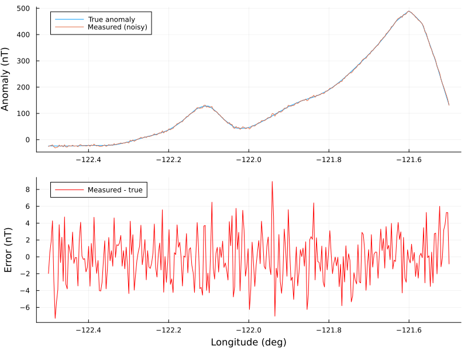

# MagNavSim

[](https://github.com/Nadjoubiii/airplane-navigation-using-a-quantum-magnetometer/actions/workflows/ci.yml)

A Julia simulation platform for **magnetic-anomaly navigation with a quantum
magnetometer**. It flies a virtual aircraft over a real-world magnetic anomaly
map (NOAA EMAG2) and generates the noisy 3-axis and scalar measurements that a
quantum magnetometer would record along the way.



*Default run: true crustal anomaly sampled from EMAG2 (blue), the simulated sensor
output (orange), and the measurement error (bottom).*

## Why

Magnetic-anomaly navigation estimates position by matching measured field values
to a map. It needs no GPS and cannot be jammed, but its accuracy is bounded by
sensor noise. Quantum magnetometers are the most sensitive sensors available, so
this project asks: *how good does the sensor need to be?* MagNavSim is the
forward model for that study. Given a map, a track and a sensor specification, it
produces the measurement stream a navigation filter would consume.

## What it does

1. Loads a single-band anomaly raster (EMAG2 GeoTIFF, or any GDAL-readable grid).
2. Builds a straight lon/lat flight track.
3. Samples the map along the track (bilinear interpolation, longitude wrap, nodata handling).
4. Converts the scalar anomaly into a 3-axis vector along the main-field direction.
5. Passes it through a quantum-magnetometer model: scale factor, bias, white noise, and low-pass dynamics.
6. Writes a summary, a CSV of all channels, and a plot.

The exact equations and simplifications are in **[docs/model.md](docs/model.md)**.

## Quick start

**Requirements:** [Julia](https://julialang.org/downloads/) 1.8+ and internet access on the first run (package download).

```sh
git clone https://github.com/Nadjoubiii/airplane-navigation-using-a-quantum-magnetometer.git
cd airplane-navigation-using-a-quantum-magnetometer

# 1. Install dependencies (first time only; precompiling Plots/GDAL takes several minutes)
julia --project=. -e "using Pkg; Pkg.instantiate()"

# 2. Run with the built-in synthetic field (no data download needed)
julia --project=. src/main.jl --synthetic
```

Results appear in `outputs/`.

### Using real data (EMAG2)

1. Download the **EMAG2 v3 upward-continued GeoTIFF** from the
   [NOAA NCEI EMAG2 page](https://www.ncei.noaa.gov/products/magnetic-anomaly-grid-emag2)
   (`EMAG2_V3_UpCont_DataTiff.tif`, about 240 MB).
2. Put it in the project root (it is git-ignored), or pass its location with `--raster`.
3. Run:

```sh
julia --project=. src/main.jl
julia --project=. src/main.jl --raster path/to/other_grid.tif
```

If the raster is missing, the runner warns and falls back to the synthetic field.

## Command-line reference

```text
julia --project=. src/main.jl [options]

  --raster PATH     Single-band anomaly raster (GeoTIFF/NetCDF).
                    Default: EMAG2_V3_UpCont_DataTiff.tif in the project root.
  --synthetic       Skip the raster and use the built-in analytic field.
  --start LON,LAT   Track start in degrees.   Default: -122.5,37.6
  --end LON,LAT     Track end in degrees.     Default: -121.5,38.6
  --steps N         Number of samples.        Default: 300
  --dt SECONDS      Sample interval.          Default: 1.0
  --noise NT        Sensor noise per axis.    Default: 3.0
  --tau SECONDS     Sensor low-pass constant. Default: 0.1
  --seed N          Seed for reproducible noise.
  --outdir DIR      Output directory.         Default: <project>/outputs
  --no-plot         Do not write the PNG plot.
  -h, --help        Show this help.
```

Examples:

```sh
# Reproducible run with a quieter sensor over a different region (EMAG2 uses 0-360 or -180..180 longitudes)
julia --project=. src/main.jl --start=-100,35 --end=-95,40 --noise 0.5 --seed 42

# Long, finely sampled flight, no plot
julia --project=. src/main.jl --steps 2000 --dt 0.1 --no-plot
```

Exit codes: `0` success, `1` simulation error (e.g. track outside the map or over nodata), `2` bad arguments.

### Outputs

Written to `outputs/` (git-ignored) or `--outdir`:

| File | Contents |
|---|---|
| `last_run_summary.txt` | timestamp, raster, sample count, track ends, true min/max, measured mean/std, measurement error mean/RMS |
| `flight.csv` | `time_s, lon, lat, true_nT, meas_nT, true_{x,y,z}, meas_{x,y,z}` (synthetic runs omit the vector and time columns) |
| `flight.png` | true vs measured anomaly and error plot |

## Using it as a Julia library

```julia
using MagNavSim

# Load the map once, run many flights
amap = load_map("EMAG2_V3_UpCont_DataTiff.tif")

sim = simulate_flight(amap, (-122.5, 37.6), (-121.5, 38.6);
                      nsteps = 500, dt = 1.0,
                      noise_std = 1.0,          # nT per axis
                      tau = 0.1,                # sensor low-pass time constant (s)
                      bias = (2.0, 0.0, 0.0),   # nT
                      seed = 1)

sim[:true]      # true anomaly along the track (nT)
sim[:meas]      # scalar sensor measurement (nT)
sim[:meas_vec]  # 3-axis sensor measurement (Vector of SVector{3})

plot_results(sim; path = "flight.png")
write_csv("flight.csv", sim)
```

No raster at hand? Build a map from any array:

```julia
data = [60sin(3x) * cos(2y) for x in 0:0.05:2, y in 2:-0.05:0]   # data[ix, iy], north at iy = 1
amap = MagneticMap(data, -0.025, 2.025, 0.05, 0.05)              # xmin, ymax, dx, dy
sim  = simulate_flight(amap, (0.2, 1.8), (1.8, 0.2); noise_std = 2.0, seed = 7)
```

Two ready-to-run scripts live in [`examples/`](examples):

| Script | Needs raster | What it shows |
|---|---|---|
| [`simple_run.jl`](examples/simple_run.jl) | yes (falls back to synthetic) | default flight, saves a plot |
| [`noise_sweep.jl`](examples/noise_sweep.jl) | no | measurement error vs. sensor noise level |

```sh
julia --project=. examples/noise_sweep.jl
```

The full function and keyword reference is in **[docs/api.md](docs/api.md)**.

## Repository layout

```text
.
├── Project.toml              Julia package definition and dependencies
├── src/
│   ├── MagNavSim.jl          module entry point and exports
│   ├── magnetic_map.jl       MagneticMap, load_map, sample_map
│   ├── quantum_sensor.jl     QuantumMagnetometer model
│   ├── simulation.jl         simulate_flight, synthetic flight, run_example
│   ├── output.jl             plots, summary, CSV export
│   ├── cli.jl                command-line parsing and runner
│   ├── emag_downloader.jl    download/reproject helpers
│   └── main.jl               CLI entry point
├── examples/                 runnable scripts
├── test/runtests.jl          test suite
├── docs/                     model description, API reference, images
└── .github/workflows/ci.yml  continuous integration
```

## Testing

```sh
julia --project=. -e "using Pkg; Pkg.test()"
```

The suite covers map indexing and longitude wrapping, a GeoTIFF round-trip including
nodata, the sensor equations (scale, bias, low-pass step response, seeded noise), flight
simulation and validation, output files, and the CLI.

## Troubleshooting

| Symptom | Fix |
|---|---|
| First run is very slow | Julia is precompiling Plots/GDAL. This happens once. |
| `Raster not found; using the synthetic field` | Download EMAG2 (see above) or pass `--raster`. |
| `DomainError ... outside map extent` | Start/end lie outside a regional raster. Global EMAG2 accepts any longitude. |
| `flight track crosses nodata` | The track passes over missing data. Choose a different track. |
| Package errors after pulling updates | `julia --project=. -e "using Pkg; Pkg.resolve(); Pkg.instantiate()"` |
| Plot fails on a headless server | Set `GKSwstype=100` (the CLI does this automatically). |

## Limitations

This is a measurement simulator, not yet a full navigation study. Tracks are straight
lines in lon/lat at fixed altitude, the field direction is constant, noise is white and
Gaussian, and there is no platform interference or attitude model. See
[docs/model.md](docs/model.md#8-known-limitations).

## Roadmap

- Navigation filter (EKF/particle filter) that estimates position from the measurement stream, using [MagNav.jl](https://github.com/MIT-AI-Accelerator/MagNav.jl).
- Location-dependent main field (IGRF) and realistic flight dynamics.
- Colored (1/f) sensor noise, drift, and attitude/heading errors.
- Physically derived quantum-sensor noise models (e.g. optically pumped and NV-diamond magnetometers) to relate sensor design parameters to position accuracy.

## Data and credits

Anomaly data: [EMAG2 v3](https://www.ncei.noaa.gov/products/magnetic-anomaly-grid-emag2),
NOAA National Centers for Environmental Information. Please cite it when publishing results.
Project of the AUB Quantum Sensing Team.
